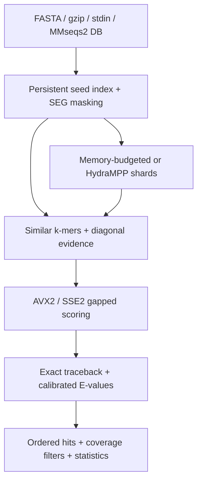

# 🗡️ Sabertooth

### *A pure-Rust reimplementation of the MMseqs2 profile/PSSM sensitivity core.*

<div align="center">


### ⚡ Profile & Sequence Search • 🧬 Translated & Profile–Profile • 🧫 Clustering • 🌳 Taxonomy • 🚀 Parallel Rust

</div>

---

# 🔬 What is Sabertooth?

**Sabertooth** is a high-performance, dependency-light **Rust** reimplementation of the
profile/PSSM sensitivity core of [MMseqs2](https://github.com/soedinglab/MMseqs2).

Sequence and profile searches use a **persistent, memory-mapped seed index**, exact
**Smith–Waterman–Gotoh** alignments, and **calibrated gapped E-values**.
The toolkit also includes translated search, profile–profile search, clustering,
MMseqs2 database interoperability, LCA taxonomy, and optional HydraMPP distribution.

The earlier reference validation reports **400/400 exact substitution-matrix cells**,
**635/700 exact PSSM cells**, and **697/700 within one quantization unit**.
See [Validation](#-validation--verified-against-the-real-mmseqs) for the scope of those results.

It ships as **one crate**: `cargo install sabertooth`, with three default runtime
dependencies (`rayon`, `flate2`, `memmap2`) and no C/C++ toolchain.

**v0.3** overhauls correctness, false-positive controls, speed, and memory use.
See [`CHANGES.md`](CHANGES.md) for the fixes and evidence, and
[`CHECKLIST.md`](CHECKLIST.md) for item-by-item status.

---

# ✨ Features

<table>
<tr>
<td width="50%">

## 🧬 Search & Alignment

* Profile (PSSM) search — per-profile calibrated statistics
* Sequence-vs-sequence search
* Smith–Waterman–Gotoh gapped alignment
* Striped **AVX2 / SSE2 SIMD** score kernels with runtime dispatch
* Banded alignment for long sequences
* K-mer + similar-k-mer prefilter
* Spaced seeds & a sensitivity dial (`-s`)
* Calibrated gapped E-values with length correction
* SEG masking & composition-bias correction
* Persistent, checksummed `.stidx` indexes
* Memory-budgeted out-of-core search
* BLAST-tab `.m8` output

</td>
<td width="50%">

## 🧫 Beyond the Core

* a3m MSA generation (`result2msa`)
* Six-frame translated search (`translatesearch`)
* Profile–profile search (`profileprofile`)
* Linclust-style clustering (`cluster`)
* LCA taxonomy (`taxonomy`)
* Database-free exhaustive SW (`easysearch`)
* MMseqs2 on-disk DB read/write (verified interop)
* Iterative (PSI-BLAST-style) profile search
* Monte-Carlo gapped-statistics calibration

</td>
</tr>
</table>

```text
✔ Exact matrix reconstruction & near-identical PSSMs in reference validation
✔ Interoperable on-disk DB format (mmseqs reads ours; we read mmseqs')
✔ Byte-identical profile-DB decode (matches `mmseqs profile2pssm`)
✔ Optional multi-node scaling via RAW-lab HydraMPP
✔ Single publishable crate, declared MSRV 1.75, no C/C++ toolchain
✔ Persistent indexes, bounded buffers & reusable on-disk shards
```

---

# ⚡ Why Sabertooth?

| Feature                          | Sabertooth |
| -------------------------------- | ---------- |
| 🦀 Pure-Rust, single crate       | ✅ |
| 🧬 Reference-validated PSSM / matrix   | ✅ |
| 🚀 Multi-threaded (rayon)        | ✅ |
| ⚙️ AVX2 / SSE2 runtime dispatch      | ✅ |
| 🔁 Iterative profile search      | ✅ |
| 🧫 Linclust-style clustering     | ✅ |
| 🌳 LCA taxonomy                  | ✅ |
| 🧠 Translated & profile–profile   | ✅ |
| 💾 MMseqs2 DB interop            | ✅ |
| 🌐 Optional HydraMPP distribution | ✅ |

---

# 📈 What’s New in v0.3?

**Before / after** (v0.2.0 default vs v0.3.0 default, same machine, compiler
and flags; every number comes from a run record in `bench/results/` — see
[Benchmarks](#-benchmarks) for the method, MMseqs2 / DIAMOND, and what did
*not* improve):

<!-- table:before_after -->
| | v0.2 | v0.3 (default) | change |
|---|---|---|---|
| *held-out SCOPe40: 4,000 queries × 14,323 domains (2 threads)* | | | |
| wall time, s | 40.0 | 7.5 | 5.3× faster |
| peak RSS, MiB | 296 | 67 | 4.4× less |
| sensitivity (AUC1) | 0.169 | 0.202 | +20% |
| true positives at E ≤ 1e-3 | 16,917 | 20,238 | +20% |
| false positives at E ≤ 1e-3 | 40 | 19 | −52% |
| false positives at matched recall 0.08 | 1,810 | 16 | 113× fewer |
| low-complexity-insert queries: FP at E ≤ 1e-3 | 282,325 | 7 |  |
| shuffled queries: chance hits per query at E ≤ 1 (≤ 1 = calibrated) | 1.43 | 0.36 | overconfident → conservative |
| *68 M residues (374,323 sequences): 1,000 queries* | | | |
| wall time, s | 127.3 | 14.1 | 9.0× faster |
| peak RSS, MiB (v0.3: mostly the memory-mapped index) | 2764 | 896 | 3.1× less |
| sensitivity (AUC1) | 0.164 | 0.190 | +16% |
| true / false positives at E ≤ 1e-3 | 3727 / 8 | 4125 / 2 |  |
| on a 1 GiB machine: wall time, s | killed (out of memory) | 20.8 (2 shards) |  |
| on a 512 MiB machine: wall time, s | — (killed at 1 GiB) | 24.8 (5 shards) |  |
| on a 256 MiB machine: wall time, s | — (killed at 1 GiB) | 36.5 (19 shards) |  |
| seed index | rebuilt in every search | built once: 14 s, 833 MiB on disk |  |
<!-- /table -->

AUC1 = fraction of each query's true homologs ranked above its first false
positive, averaged over queries. "Matched recall 0.08" = the false positives
admitted by the time each tool has found 8% of all true homolog pairs.

---

# 🧱 Architecture



Sequence searches apply composition-bias correction and scoring masks by default.
Shards use whole-database E-values; GPU slots are for scheduling only.

---

# 🦀 Tech Stack

| Component               | Technology                          |
| ----------------------- | ----------------------------------- |
| Core engine             | Rust (edition 2021, declared MSRV 1.75)      |
| Parallelism             | rayon                               |
| Compressed input        | flate2 — streamed gzip FASTA         |
| Persistent index        | memmap2 — memory-mapped `.stidx`     |
| SIMD                    | striped AVX2 / SSE2 with runtime dispatch           |
| Distributed (optional)  | hydra-mpp-core (RAW-lab HydraMPP)    |
| Serialization (optional)| serde + bincode                     |
| CLI                     | hand-rolled, zero-dependency        |

The **default build depends on `rayon`, `flate2`, and `memmap2`.** The distributed backend dependencies
(`hydra-mpp-core`, `serde`) are behind the opt-in `distributed` feature.

---

# 🚀 Installation

## 1️⃣ Install Rust

```bash
curl --proto '=https' --tlsv1.2 -sSf https://sh.rustup.rs | sh
rustup default stable
```

## 2️⃣ Install Sabertooth

### From crates.io

```bash
cargo install sabertooth
```

### From source

```bash
git clone https://github.com/raw-lab/sabertooth
cd sabertooth
cargo install --path .
```

### With the optional distributed backend

```bash
cargo install sabertooth --features distributed
```

---

## 🛠️ Build & Self-check

```bash
cargo build --release                       # sabertooth binary in target/release/
cargo build --release --features distributed  # + HydraMPP distributed backend
cargo test --release                        # unit + CLI integration tests
cargo test --release --features distributed # + distributed parity tests
./target/release/sabertooth doctor          # self-checks
```

The crate declares `rust-version = "1.75"`; it was developed and tested with
rustc 1.97 (see "Limitations"). No `target-cpu` flags are needed: AVX2 is
detected at run time (SSE2, part of every x86-64 CPU, is the fallback; other
architectures use the exact scalar kernels).

---

# ⚡ Quick Start

## 💾 Build Once, Search Repeatedly

```bash
sabertooth makedb proteins.fasta.gz protDB          # sequence database (MMseqs2 format)
sabertooth createindex protDB --memory-limit 2G     # persistent seed index protDB.stidx
sabertooth search queries.fasta protDB --out hits.m8 --stats-json stats.json
```

## 🧬 Profile (PSSM) search

```bash
# build a PSSM from an MSA, then search it against a target DB
sabertooth msa2profile family.a3m --out family.pssm
sabertooth profilesearch family.a3m proteins.fasta --out hits.m8 --evalue 1e-5
```

## 🔎 Sequence search

```bash
sabertooth search queries.fasta proteins.fasta -s 7.5 --out hits.m8
```

## 🧠 Translated (six-frame) search

```bash
sabertooth translatesearch contigs.fasta proteins.fasta --min-orf 30
```

## 🧫 Cluster

```bash
sabertooth cluster proteins.fasta --min-seq-id 0.5 --out clusters.tsv
```

## 🌳 Taxonomy (LCA)

```bash
sabertooth taxonomy queries.fasta proteins.fasta \
    --nodes nodes.dmp --names names.dmp --seqmap seqid2taxid.tsv
```

---

# 🧰 Commands

| Command                       | What it does |
| ----------------------------- | ------------ |
| `createdb`                    | Validate + normalise a sequence FASTA |
| `makedb` / `convert2fasta`    | Write / read the **MMseqs2 on-disk DB** (interoperable with `mmseqs`) |
| `createindex` | Build a persistent, memory-budgeted `.stidx` seed index |
| `indexinfo` | Inspect a seed index; `--verify` checks all section checksums |
| `msa2profile`                 | Build a PSSM from an a3m / aligned-FASTA MSA |
| `result2msa`                  | Search, then emit an **a3m MSA** per query |
| `search`                      | Sequence-vs-sequence search |
| `easysearch`                  | **Database-free** exhaustive SW (no prefilter index) |
| `profilesearch`               | Profile (PSSM) search; `--num-iterations` for PSI-BLAST-style |
| `profileprofile`              | **Profile-vs-profile** search (column co-emission) |
| `translatesearch`             | **Six-frame** translated nucleotide search |
| `cluster`                     | **Linclust-style** clustering (rep→member TSV) |
| `taxonomy`                    | **LCA** taxonomic assignment from hits |
| `profiledb2pssm`              | Read an MMseqs2 **profile DB** (`dbtype 2`) as a PSSM table |
| `align`                       | Pairwise local alignments |
| `calibrate`                   | Monte-Carlo gapped Gumbel statistics (λ, K) |
| `doctor` / `info` / `version` | Self-check, matrix report, banner |

Run `sabertooth help` for the full flag list.

---

# 💾 Databases & Indexes

| step | command | writes | notes |
|---|---|---|---|
| sequence database | `makedb <in.fasta[.gz]\|db> <db>` | `<db>`, `<db>.index`, `.dbtype`, `<db>_h`, `.lookup`, `.source` | MMseqs2-compatible amino-acid DB (readable by `mmseqs`) |
| seed index | `createindex <db\|fasta> [out.stidx]` | `<db>.stidx` | persistent, versioned, checksummed k-mer index + compact residue arena |

* **Inputs** for every command: FASTA, gzip FASTA (streamed), `-` (stdin),
  an MMseqs2 database prefix, and a `.stidx` seed index (its sequences and
  identifiers; an index keeps no header descriptions). (A database made
  by `mmseqs createdb` gives the same hits as its FASTA, but `createdb`
  shuffles entries by default, so ties may be listed in another order;
  `--shuffle 0` keeps them identical.) Empty inputs,
  malformed FASTA (with the offending line), corrupt gzip, compressed / split /
  profile / nucleotide MMseqs2 databases and inconsistent `.index` files are
  rejected with an explanation instead of being searched as "no hits".
* **Index use.** `search` uses `<target>.stidx` automatically when it exists,
  was built with the search's own seed and masking (its defaults — k = 6
  for sequence search, 5 for profile search, masking on — or the explicit
  `--k` / `--spaced` / `--mask`), and is not stale (size and mtime of the
  source files are recorded — no rescan). An index built differently is
  never adopted silently, so results do not depend on which indexes exist.
  Otherwise it builds a temporary index (removed afterwards) and says so on
  stderr (and in `--stats-json` → `index.source`); `--require-index` turns
  that into an error. `indexinfo <file> --verify`
  checks every section checksum.
* **Build memory.** `createindex` streams sequences into the output file and
  builds postings in partitions sized to half of `--memory-limit` (default:
  a 1 GiB partition buffer); the postings, k-mer table and residues are
  identical for any budget (`small_budget_forces_multiple_partitions_with_identical_output`).
  Writes are atomic (temp file + rename): an interrupted build never leaves an
  index that opens. Measured build times and peaks under 1 GiB / 512 MiB /
  256 MiB limits are in [Index build](#-index-build).
* **Size.** 12.8 bytes per residue for the 68 M-residue benchmark database
  (1 B residues, ~7.6 B postings, 3.3 B k-mer table, identifiers, and a
  51 MB direct `(k−1)`-prefix bucket table used from 51 M residues on);
  16.5 bytes per residue for the 2.6 M-residue SCOPe40, almost all of the
  difference being the k-mer table (8 bytes per distinct k-mer: 0.87
  distinct k-mers per residue there, 0.42 in the larger database, where
  k-mers repeat more). The k-mer table cannot exceed 20⁶ entries, so much
  larger databases should approach ≈ 9 bytes per residue (extrapolated, not
  measured).

---

# 🔎 Searching

```bash
sabertooth search  <query> <target> [options]   # prefiltered sequence search
sabertooth easysearch <query> <target>          # exhaustive Smith–Waterman (no prefilter)
sabertooth profilesearch <msa> <target>         # PSSM search (per-profile calibrated)
```

## 🎛️ Sensitivity Presets

`-s` sets the similar-k-mer threshold, the per-window k-mer cap and the
ungapped gate together (explicit `--kmer-score`, `--max-kmers`,
`--min-diag-score` override). Measured on the tuning split (1,000 queries vs
SCOPe40, 2 threads):

<!-- table:presets -->
| `-s` | k-mer score / cap / gate | wall s | AUC1 | TP@1e-3 | FP@1e-3 | FP@E10 |
|---|---|---|---|---|---|---|
| 1 | 26 / 192 / 30 | 0.89 | 0.1434 | 3129 | 1 | 1759 |
| 2 | 25 / 256 / 30 | 1.03 | 0.1631 | 3575 | 1 | 2282 |
| 4 | 24 / 320 / 30 | 1.32 | 0.1798 | 3983 | 1 | 2944 |
| 5.7 (default) | 22 / 512 / 33 | 1.59 | 0.2032 | 4549 | 1 | 4140 |
| 6.5 | 21 / 640 / 33 | 2.64 | 0.2165 | 4789 | 2 | 4915 |
| 7.5 | 19 / 1024 / 34 | 4.17 | 0.2326 | 5083 | 2 | 6237 |
| 8.5 | 17 / 1536 / 36 | 6.80 | 0.2375 | 5208 | 2 | 6819 |
| 9 | 16 / 2048 / 38 | 8.29 | 0.2376 | 5242 | 2 | 6736 |
<!-- /table -->

## ⚙️ Pipeline & Search Controls

1. **Seeds.** For each query window the exact top-`--max-kmers` similar
   k-mers scoring ≥ `--kmer-score` (ties broken deterministically), plus the
   query's own k-mer. Low-complexity windows (SEG 12/2.2/2.5) are not seeded
   (`--mask`), and low-complexity target regions are not indexed.
2. **Hits** are gathered in bounded target blocks (`--hit-block`); per target
   up to `--prefilter-diags` diagonals are extended ungapped (X-drop
   `--ungapped-xdrop`, or whole-diagonal Kadane with `0`) and co-linear
   segments are chained. Targets reaching `--min-diag-score` are candidates.
   `--max-candidates` / `--max-seed-occ` are explicit caps (off by default,
   counted in the stats when they bind).
3. **Gapped score.** Exact striped Smith–Waterman–Gotoh: a `u8` pass (32 AVX2
   lanes) and, when its headroom is exceeded, `i16` (16 lanes); scalar only for
   `open ≤ extend` or `i16` saturation.
4. **Traceback** (only for candidates whose score passes `--evalue`): end cell
   from the SIMD pass, start from a SIMD pass over the reversed prefixes, then a
   banded traceback widened until it reproduces the score — exact, with fixed
   tie rules, so the output never depends on kernel, threads, memory limit or
   sharding.
5. **Statistics.** `E = K·(m−ℓ)·(N−n·ℓ)·e^(−λS)` with gapped `λ, K` and the
   length correction `ℓ` fitted on random sequences for the scoring scheme in
   use (BLOSUM62, 11/1, with or without composition-bias correction; table in
   `bench/results/calibration_table.txt`, reproducible with
   `sabertooth calibrate --table --samples 20000 --seed 24301`). `N`, `n` are
   always the whole database. **An E-value is the expected number of chance
   alignments with at least this score in a database of this size — not a
   probability, p-value, FDR or q-value.** Profile searches fit `λ, K` for each
   PSSM by simulation.
6. **False-positive controls** (sequence queries, on by default):
   composition-bias correction (`--comp-bias-corr`, MMseqs2's local
   correction with its own calibrated statistics) and hard masking of
   low-complexity query positions in scoring (`--mask-scoring`, SEG 15/2.3/2.3:
   their score rows become the `X` row). Coverage filters `--min-qcov` /
   `--min-tcov` are applied after traceback.

`--max-hits` (default 300) only limits output per query. Output is BLAST tab
(`query target pident alnlen mismatch gapopen qstart qend tstart tend evalue
bits`, 1-based); `--extra-cols` appends raw score, lengths, coverages and the
CIGAR. Queries are streamed in batches (`--query-batch`) and results are
written in input order; duplicate query identifiers stay separate records.
Errors (unreadable or malformed input, a corrupt index or shard) end the run
with a message and exit status 1; an `--out` file may then be incomplete.

## 🧠 Memory & Threads

`--threads` (default: all cores) parallelises across queries, or across
candidates for batches smaller than the thread count — never both.
`--memory-limit` sizes threads, query batches and per-worker buffers to a
budget. The seed index is memory-mapped: its pages are file-backed and
reclaimable, and peak RSS includes the index pages a search touches.

**Less RAM than the index (out-of-core search).** With `--memory-limit`,
`search` also checks whether the mapped index fits next to the planned
working memory (¾ of the budget minus worker scratch). If not, the index is
cut into residue-balanced shards that each fit (persistent, in
`<index>.shards-<N>/` or `--shard-dir`, built once and reused while the
manifest matches), and every query batch is searched against one shard at a
time; hits are merged per query with whole-database E-values. The cost is
one seed generation per shard and one read of the shards per query batch;
the alternative — mapping an index larger than RAM — pages the index in and
out on every query (23× slower in the benchmark below). `--shards N` sets
the number of shards explicitly (`--shards 1`: never shard). Nothing in the
output depends on any of these settings (tested byte-for-byte; the only
exceptions are the off-by-default caps `--max-candidates` / `--max-seed-occ`,
which then apply per shard).

`--stats` / `--stats-json` report stage CPU times (seed generation, hit
collection, diagonal evidence, gapped scoring, traceback), every prefilter
and alignment counter, the memory plan, peak RSS and page faults.

---

# 📊 Comparison with MMseqs2

Sabertooth targets the **profile/PSSM sensitivity path**, then extends outward. Legend:
✅ implemented · ⚠️ partial (scope noted) · ❌ not implemented.

| Capability | MMseqs2 | Sabertooth |
| --- | :---: | --- |
| Substitution-matrix reconstruction | ✅ | ✅ (cell-identical) |
| PSSM / profile construction | ✅ | ✅ (635/700 exact cells in reference validation) |
| a3m / aligned-FASTA MSA input | ✅ | ✅ |
| K-mer + similar-k-mer prefilter | ✅ | ✅ (scalar) |
| Spaced seeds + sensitivity (`-s`) | ✅ | ✅ (`--spaced`, `-s`) |
| Ungapped diagonal prefilter | ✅ | ✅ |
| Smith–Waterman–Gotoh gapped alignment | ✅ | ✅ |
| Banded alignment (long sequences) | ✅ | ✅ (`--band`) |
| Karlin–Altschul E-values | ✅ | ✅ (calibrated gapped λ / K + length correction) |
| Profile search (PSSM vs sequences) | ✅ | ✅ |
| Sequence search | ✅ | ✅ |
| BLAST-tab `.m8` output | ✅ | ✅ |
| SIMD-striped alignment kernel | ✅ | ✅ (AVX2 / SSE2, runtime dispatch) |
| Gapped-statistics calibration | ✅ (ALP) | ✅ (Monte-Carlo Gumbel; `calibrate`) |
| Iterative profile search | ✅ | ✅ (`--num-iterations`) |
| MSA generation (`result2msa`) | ✅ | ✅ (a3m) |
| Clustering / linclust | ✅ | ✅ (minimizer + greedy set-cover) |
| Taxonomy (LCA) | ✅ | ✅ (nodes.dmp + weighted LCA) |
| Profile–profile search | ✅ | ✅ (column co-emission) |
| Nucleotide / translated search | ✅ | ✅ (6-frame ORFs) |
| On-disk sequence DB | ✅ | ✅ (**verified interop with `mmseqs`**) |
| On-disk profile DB (`dbtype 2`) | ✅ | ✅ read (**byte-identical to `profile2pssm`**); write ❌ |
| Database-free / streaming search | ✅ (`easy-search`) | ✅ (index-free exhaustive SW) |
| Distributed (multi-node) execution | ✅ (MPI) | ✅ (HydraMPP; single-host parity tested, multi-node unbenchmarked) |
| GPU support | ✅ (GPU SW kernel) | ⚠️ GPU-aware **scheduling + pinning** only (no CUDA kernel yet) |

**Two honest scope notes.** The GPU path is GPU-aware *scheduling and device pinning* via
HydraMPP — the exact hook a CUDA aligner would slot into — but the SW math still runs on
the SIMD CPU kernel. And the profile-DB support is read-only for now (write is not yet
implemented). See [`COMPARISON.md`](COMPARISON.md) for the full discussion.

---

# 🧪 Validation — verified against the *real* `mmseqs`

Validation is against a **compiled `mmseqs` binary**, not a second reimplementation.

| Quantity (profile PSSM) | Agreement with MMseqs2 |
| --- | --- |
| Substitution-matrix cells | **400 / 400 exact** |
| PSSM cells, exact | **635 / 700 (90.7%)** |
| PSSM cells, within 1 quantization unit | **697 / 700 (99.6%)** |
| Profile-search hits & ranking | **same homologs, same order** |

**On-disk format interoperability — both directions:**

```bash
sabertooth makedb proteins.fasta protDB      # mmseqs convert2fasta reads it ✅
mmseqs     createdb proteins.fasta mmDB       # sabertooth convert2fasta reads it ✅
# → sequences identical both ways
```

**Profile-DB decode is byte-identical.** `sabertooth profiledb2pssm` reproduces
`mmseqs profile2pssm` output **byte-for-byte** on the same profile DB — including the
`score / 4` alignment-profile relationship (`Sequence.cpp:334`) and the
`Neff = 2^((b−1)/64)` decode. The 25-byte column layout was read out of the MMseqs2
source and verified on real files. Full details, including a binary-framing gotcha (profile
payloads legitimately contain `0x0A`, so they use bare-`\0` framing, **not** the text DB's
`\n\0`), are in [`VALIDATION.md`](VALIDATION.md).

These are the earlier reference-validation results retained from the original README.
The v0.3 search path now uses calibrated gapped statistics with length correction;
profile searches calibrate λ and K per PSSM. The earlier analytic-statistics description
is superseded. Profile search is not included in the comparative benchmark below.

---

# 📊 Benchmarks

Methodology, datasets (with checksums) and commands: [`bench/README.md`](bench/README.md).
All numbers: one 2-vCPU Xeon @ 2.1 GHz VM, 8 GiB RAM, 2 threads (1-thread
and memory-limited runs are marked), E ≤ 10 and ≤ 4,000 hits per query for
every tool (full PR range), each tool on its own prebuilt database. Held-out
and large-database timings are medians of 3 repetitions (min–max shown),
except the 577.9 s unsharded 512 MiB run (one repetition; an earlier pass
measured 580.9 s). The tuning and null suites are single runs.
Machine-readable results: `bench/results/*.json` (compact) and
`bench/results/runs/` (every run record: command, per-repetition timings,
evaluation, Sabertooth's stage counters); figures: `bench/results/*_roc.png`.
The tables below are generated from those records by
`bench/readme_tables.py`.

## 🏁 Held-out Homology Search: Sabertooth vs MMseqs2 and DIAMOND

<!-- table:headline -->
| | v0.2 | **v0.3 default** (`-s 5.7`) | v0.3 `-s 2` | v0.3 `-s 7.5` | MMseqs2 `-s 5.7` | MMseqs2 `-s 7.5` | DIAMOND `--sensitive` | DIAMOND `--ultra-sensitive` |
|---|---|---|---|---|---|---|---|---|
| *held-out SCOPe40: 4,000 queries × 14,323 domains* |  |  |  |  |  |  |  |  |
| wall time, s (median of 3) | 40.03 | 7.55 | 4.43 | 17.56 | 6.35 | 26.86 | 4.64 | 14.32 |
| peak RSS, MiB | 296 | 67 | 63 | 82 | 886 | 1773 | 37 | 80 |
| AUC1 (sensitivity to 1st FP) | 0.1687 | 0.2017 | 0.1538 | 0.2313 | 0.1595 | 0.2335 | 0.1660 | 0.2456 |
| true positives at E ≤ 1e-3 | 16917 | 20238 | 14056 | 23709 | 16661 | 25936 | 20124 | 29504 |
| false positives at E ≤ 1e-3 | 40 | 19 | 15 | 20 | 12 | 18 | 14 | 16 |
| FP at matched recall 0.07 | 48 | 8 | 735 | 7 | 18 | 6 | 7 | 6 |
| FP at matched recall 0.08 | 1810 | 16 | — | 8 | 2053 | 6 | 11 | 6 |
| FP at matched recall 0.10 | — | 419 | — | 22 | — | 11 | — | 7 |
| *low-complexity control (1,000 LC-insert queries × SCOPe40 + decoys)* |  |  |  |  |  |  |  |  |
| TP / FP at E ≤ 1e-3 | 3685 / 282325 | 3922 / 7 | 2821 / 6 | 4422 / 11 | 3471 / 55 | 5101 / 714 | 4004 / 3 | 5520 / 5 |
| *null: 1,000 shuffled queries (expected chance hits per query = E)* |  |  |  |  |  |  |  |  |
| chance hits per query at E ≤ 1 | 1.429 | 0.362 | — | 0.516 | 0.076 | — | 0.009 | — |
| chance hits per query at E ≤ 0.01 | 0.0310 | 0.0040 | — | 0.0060 | 0.0010 | — | 0.0020 | — |
| *68 M residues (374,323 seqs): 1,000 queries* |  |  |  |  |  |  |  |  |
| wall time, s | 127.3 | 14.1 | 9.3 | 37.4 | 5.2 | — | 38.6 | — |
| peak RSS, MiB | 2764 | 896 | 857 | 950 | 1324 | — | 263 | — |
| AUC1 | 0.1640 | 0.1900 | 0.1537 | 0.2140 | 0.1614 | — | 0.1700 | — |
| TP / FP at E ≤ 1e-3 | 3727 / 8 | 4125 / 2 | 3318 / 1 | 4524 / 2 | 3585 / 1 | — | 3724 / 1 | — |
<!-- /table -->

<!-- table:eval_eval -->
**held-out homology (4,000 queries)**

| run | wall s | RSS MiB | AUC1 | TP@1e-3 | FP@1e-3 | FDP@1e-3 | FP@E10 | FP@rec 0.06 | FP@rec 0.07 | FP@rec 0.08 | FP@rec 0.10 |
|---|---|---|---|---|---|---|---|---|---|---|---|
| v02_default | 40.03 (39.95–40.96) | 296 | 0.1687 | 16917 | 40 | 0.0024 | 53137 | 10 | 48 | 1810 | — |
| st_s2 | 4.43 (4.40–4.45) | 63 | 0.1538 | 14056 | 15 | 0.0011 | 9379 | 17 | 735 | — | — |
| st_s5.7 | 7.55 (7.20–7.88) | 67 | 0.2017 | 20238 | 19 | 0.0009 | 16577 | 6 | 8 | 16 | 419 |
| st_s7.5 | 17.56 (17.26–17.97) | 82 | 0.2313 | 23709 | 20 | 0.0008 | 24992 | 6 | 7 | 8 | 22 |
| mm_s5.7 | 6.35 (6.11–6.66) | 886 | 0.1595 | 16661 | 12 | 0.0007 | 2604 | 7 | 18 | 2053 | — |
| mm_s7.5 | 26.86 (26.70–28.03) | 1773 | 0.2335 | 25936 | 18 | 0.0007 | 12157 | 6 | 6 | 6 | 11 |
| dm_sensitive | 4.64 (4.60–4.69) | 37 | 0.1660 | 20124 | 14 | 0.0007 | 244 | 6 | 7 | 11 | — |
| dm_ultra | 14.32 (13.95–14.32) | 80 | 0.2456 | 29504 | 16 | 0.0005 | 2575 | 6 | 6 | 6 | 7 |
| st_exhaustive | 112.67 (111.31–115.04) | 28 | 0.2636 | 25854 | 22 | 0.0009 | 52142 | 6 | 7 | 7 | 17 |
<!-- /table -->

* **v0.2 → v0.3** at the default operating point: 5× faster, 4× less memory,
  20% more sensitive, half the false positives at E ≤ 1e-3, and 113× fewer
  false positives at matched recall 0.08.
* The first false positives are the same 6 cross-fold SCOP pairs in every
  run (strong alignments across folds, i.e. disputable labels; v0.2, `-s 2`
  and MMseqs2 `-s 5.7` add a few more by recall 0.06), so differences of a
  few FPs at E ≤ 1e-3 carry little signal; FP at matched recall 0.08–0.10
  separates the tools.
* **vs MMseqs2 `-s 5.7`**: more sensitive (AUC1 0.202 vs 0.160; 16 vs 2,053
  FPs at matched recall 0.08), 19% slower, 13× less memory. At `-s 7.5` the
  two are close in sensitivity (AUC1 0.231 vs 0.234) and Sabertooth is 1.5×
  faster with 22× less memory.
* **vs DIAMOND**: `--sensitive` is faster and lighter than the default but
  less sensitive (0.166); `--ultra-sensitive` is the most sensitive
  prefiltered tool here (0.246) and faster than `-s 7.5` (see limitations).
* **Exhaustive Smith–Waterman** with Sabertooth's scoring reaches AUC1 0.264:
  the prefilter costs 23% of that at the default and 12% at `-s 7.5`.
* At loose thresholds (E ≤ 10) Sabertooth reports more weak hits than MMseqs2
  or DIAMOND (it aligns more candidates); its calibrated E-values keep their
  number below the nominal E per query (see the null section).

## 🛡️ False-positive Controls

<!-- table:eval_lc -->
**low-complexity inserts vs SCOPe40 + decoys**

| run | wall s | RSS MiB | AUC1 | TP@1e-3 | FP@1e-3 | FDP@1e-3 | FP@E10 | FP@rec 0.04 | FP@rec 0.06 | FP@rec 0.07 | FP@rec 0.08 |
|---|---|---|---|---|---|---|---|---|---|---|---|
| v02_default | 114.74 (113.64–115.60) | 697 | 0.0513 | 3685 | 282325 | 0.9871 | 341983 | 140154 | 282419 | 308692 | 328486 |
| st_s2 | 1.54 (1.53–1.57) | 106 | 0.1321 | 2821 | 6 | 0.0021 | 1273 | 3 | 124 | — | — |
| st_s5.7 | 2.31 (2.30–2.76) | 111 | 0.1675 | 3922 | 7 | 0.0018 | 2194 | 3 | 4 | 14 | 45 |
| st_s7.5 | 6.14 (6.06–6.24) | 132 | 0.1897 | 4422 | 11 | 0.0025 | 3255 | 3 | 3 | 11 | 22 |
| mm_s5.7 | 1.92 (1.86–1.96) | 906 | 0.1343 | 3471 | 55 | 0.0156 | 632 | 17 | 90 | 336 | — |
| mm_s7.5 | 9.18 (8.87–9.22) | 1811 | 0.1726 | 5101 | 714 | 0.1228 | 4726 | 100 | 231 | 345 | 573 |
| dm_sensitive | 4.20 (4.10–4.30) | 46 | 0.1437 | 4004 | 3 | 0.0007 | 68 | 3 | 3 | 5 | — |
| dm_ultra | 9.99 (9.87–10.10) | 89 | 0.1936 | 5520 | 5 | 0.0009 | 382 | 3 | 3 | 3 | 3 |
<!-- /table -->

Every LC-insert query has a 30–60-residue homopolymer / tandem-repeat /
biased stretch; the database adds 2,000 low-complexity and 2,000
compositionally biased decoys. v0.2 reported 282,325 false positives at
E ≤ 1e-3 (99% of its hits); v0.3 reports 7. What each control contributes
(tuning split, default preset, one control or heuristic switched off at a
time):

<!-- table:ablation_lc -->
**low-complexity tuning queries vs SCOPe40 + decoys**

| run | wall s | RSS MiB | AUC1 | TP@1e-3 | FP@1e-3 | FDP@1e-3 | FP@E10 | FP@rec 0.04 | FP@rec 0.06 | FP@rec 0.07 | FP@rec 0.08 |
|---|---|---|---|---|---|---|---|---|---|---|---|
| st_s5.7 | 2.71 | 111 | 0.1838 | 3652 | 1 | 0.0003 | 2250 | 0 | 1 | 23 | 267 |
| st_s5.7_nomaskscore | 2.47 | 110 | 0.1740 | 3786 | 224 | 0.0559 | 2874 | 58 | 216 | 343 | 630 |
| st_s5.7_nocbc | 2.43 | 111 | 0.1873 | 3826 | 17 | 0.0044 | 2957 | 1 | 13 | 39 | 198 |
| st_s5.7_nomask | 6.89 | 182 | 0.1872 | 3725 | 32 | 0.0085 | 5693 | 0 | 32 | 298 | 1320 |
| st_s5.7_plain | 22.83 | 381 | 0.0651 | 4124 | 361454 | 0.9887 | 476785 | 158451 | 313009 | 382869 | 428096 |
| st_s5.7_kadane | 2.89 | 110 | 0.1840 | 3655 | 1 | 0.0003 | 2263 | 0 | 1 | 20 | 243 |
| st_s5.7_diag1 | 2.13 | 110 | 0.1749 | 3516 | 1 | 0.0003 | 2071 | 0 | 3 | 50 | 854 |
| st_v02seeds | 3.16 | 105 | 0.1528 | 3052 | 1 | 0.0003 | 1564 | 1 | 62 | — | — |
<!-- /table -->

<!-- table:ablation_tune -->
**tuning split (1,000 queries vs SCOPe40)**

| run | wall s | RSS MiB | AUC1 | TP@1e-3 | FP@1e-3 | FDP@1e-3 | FP@E10 | FP@rec 0.06 | FP@rec 0.07 | FP@rec 0.08 | FP@rec 0.10 |
|---|---|---|---|---|---|---|---|---|---|---|---|
| st_s5.7 | 1.59 | 64 | 0.2032 | 4549 | 1 | 0.0002 | 4140 | 1 | 1 | 13 | — |
| st_s5.7_nomaskscore | 1.63 | 64 | 0.2036 | 4564 | 1 | 0.0002 | 4164 | 1 | 1 | 12 | 4079 |
| st_s5.7_nocbc | 1.99 | 64 | 0.2088 | 4763 | 3 | 0.0006 | 5292 | 1 | 1 | 8 | 2838 |
| st_s5.7_nomask | 2.37 | 66 | 0.2081 | 4628 | 1 | 0.0002 | 4422 | 1 | 1 | 11 | 2429 |
| st_s5.7_plain | 2.32 | 66 | 0.2150 | 4882 | 4 | 0.0008 | 5893 | 1 | 1 | 6 | 1266 |
| st_s5.7_kadane | 2.18 | 63 | 0.2036 | 4562 | 1 | 0.0002 | 4157 | 1 | 1 | 12 | 3820 |
| st_s5.7_diag1 | 1.91 | 63 | 0.1934 | 4351 | 1 | 0.0002 | 3847 | 1 | 1 | 48 | — |
| st_v02seeds | 1.99 | 60 | 0.1662 | 3657 | 2 | 0.0005 | 2783 | 3 | 167 | — | — |
<!-- /table -->

`nomaskscore` = `--mask-scoring 0`, `nocbc` = `--comp-bias-corr 0`, `nomask`
= `--mask 0` (seed masking), `plain` = all three off, `kadane` =
`--ungapped-xdrop 0`, `diag1` = `--prefilter-diags 1`, `v02seeds` = v0.2's
seeding parameters with the v0.3 engine. Single runs; the wall times of
`nomask` and `plain` include building a temporary unmasked index (0.4–1 s),
because the persistent index is masked. The controls overlap: with any one
of them switched off (the other two on) the LC tuning queries give 17–224
false positives at E ≤ 1e-3, with all three off 361,454 — the same
magnitude as v0.2 on the held-out LC set (282,325).

## 🧬 Fragments & Two-domain Queries

<!-- table:eval_frag -->
**fragments (30–60% of the domain)**

| run | wall s | RSS MiB | AUC1 | TP@1e-3 | FP@1e-3 | FDP@1e-3 | FP@E10 | FP@rec 0.03 | FP@rec 0.04 | FP@rec 0.05 | FP@rec 0.06 |
|---|---|---|---|---|---|---|---|---|---|---|---|
| v02_default | 4.80 (4.79–4.82) | 294 | 0.0970 | 1978 | 6 | 0.0030 | 8441 | 4 | 139 | 6998 | — |
| st_s2 | 0.40 (0.37–0.41) | 58 | 0.0871 | 1562 | 4 | 0.0026 | 2150 | 7 | 822 | — | — |
| st_s5.7 | 0.78 (0.72–0.79) | 61 | 0.1171 | 2272 | 4 | 0.0018 | 3827 | 4 | 5 | 47 | 621 |
| st_s7.5 | 1.80 (1.71–1.88) | 69 | 0.1387 | 2710 | 4 | 0.0015 | 5739 | 3 | 4 | 5 | 39 |
| mm_s5.7 | 0.65 (0.64–0.68) | 884 | 0.0796 | 1827 | 3 | 0.0016 | 517 | 3 | 409 | — | — |
| mm_s7.5 | 3.24 (3.22–3.24) | 1761 | 0.1324 | 2920 | 4 | 0.0014 | 2664 | 3 | 3 | 4 | 31 |
| dm_sensitive | 1.88 (1.82–1.90) | 35 | 0.0929 | 2315 | 3 | 0.0013 | 26 | 3 | 3 | — | — |
| dm_ultra | 4.15 (3.95–4.34) | 56 | 0.1320 | 3422 | 3 | 0.0009 | 264 | 3 | 3 | 3 | 4 |
<!-- /table -->

<!-- table:eval_multi -->
**two-domain fusions**

| run | wall s | RSS MiB | AUC1 | TP@1e-3 | FP@1e-3 | FDP@1e-3 | FP@E10 | FP@rec 0.06 | FP@rec 0.07 | FP@rec 0.08 | FP@rec 0.10 |
|---|---|---|---|---|---|---|---|---|---|---|---|
| v02_default | 28.84 (28.59–29.10) | 295 | 0.1171 | 8438 | 13 | 0.0015 | 19414 | 7 | 22 | 1029 | — |
| st_s2 | 2.39 (2.38–2.58) | 65 | 0.1048 | 6954 | 9 | 0.0013 | 2598 | 11 | 477 | — | — |
| st_s5.7 | 4.01 (3.99–4.46) | 70 | 0.1402 | 9683 | 12 | 0.0012 | 4422 | 3 | 5 | 12 | 469 |
| st_s7.5 | 8.96 (8.94–9.09) | 84 | 0.1621 | 11109 | 12 | 0.0011 | 6637 | 3 | 3 | 6 | 16 |
| mm_s5.7 | 3.35 (3.19–3.40) | 885 | 0.1059 | 7871 | 6 | 0.0008 | 732 | 5 | 12 | — | — |
| mm_s7.5 | 15.06 (14.94–15.32) | 1768 | 0.1656 | 11991 | 7 | 0.0006 | 3635 | 3 | 3 | 4 | 8 |
| dm_sensitive | 3.29 (3.16–3.34) | 37 | 0.1114 | 9399 | 5 | 0.0005 | 100 | 3 | 4 | 9 | — |
| dm_ultra | 8.50 (8.30–8.51) | 59 | 0.1755 | 13384 | 7 | 0.0005 | 969 | 3 | 3 | 3 | 5 |
<!-- /table -->

## 🧪 E-value Calibration on Null Data

<!-- table:null -->
| run | workload | hits E≤1e-3 | E≤0.01 | E≤0.1 | E≤1 | observed/expected at E≤0.1 | at E≤1 |
|---|---|---|---|---|---|---|---|
| v02_default | null_q | 4 | 31 | 208 | 1429 | 2.080 | 1.429 |
| st_s5.7 | null_q | 1 | 4 | 37 | 362 | 0.370 | 0.362 |
| st_s7.5 | null_q | 1 | 6 | 55 | 516 | 0.550 | 0.516 |
| st_s5.7_plain | null_q | 2 | 10 | 72 | 569 | 0.720 | 0.569 |
| st_exhaustive | null_q | 1 | 9 | 89 | 931 | 0.890 | 0.931 |
| st_exhaustive_plain | null_q | 2 | 21 | 177 | 1515 | 1.770 | 1.515 |
| mm_s5.7 | null_q | 0 | 1 | 13 | 76 | 0.130 | 0.076 |
| dm_sensitive | null_q | 0 | 2 | 3 | 9 | 0.030 | 0.009 |
| v02_default | null_db | 18 | 113 | 796 | 5765 | 1.990 | 1.441 |
| st_s5.7 | null_db | 3 | 13 | 169 | 1448 | 0.422 | 0.362 |
| st_s7.5 | null_db | 4 | 15 | 229 | 2098 | 0.573 | 0.524 |
| st_s5.7_plain | null_db | 9 | 28 | 274 | 2174 | 0.685 | 0.543 |
| st_exhaustive | null_db | 5 | 27 | 356 | 3762 | 0.890 | 0.941 |
| st_exhaustive_plain | null_db | 12 | 53 | 589 | 5772 | 1.472 | 1.443 |
| mm_s5.7 | null_db | 3 | 5 | 35 | 285 | 0.088 | 0.071 |
| dm_sensitive | null_db | 3 | 5 | 23 | 56 | 0.057 | 0.014 |
<!-- /table -->

`null_q`: 1,000 composition-preserving shuffles of real queries vs SCOPe40
(expected chance hits with E ≤ x: 1,000·x); `null_db`: the 4,000 held-out
queries vs a shuffled SCOPe40 (expected 4,000·x). Exhaustive Smith–Waterman
measures the statistics themselves: observed/expected ≈ 0.9 — calibrated
(slightly conservative). The prefiltered search is more conservative (the
prefilter drops most chance alignments). v0.2 was overconfident (2× at
E ≤ 0.1). Without composition-bias correction and masking (`_plain`),
shuffled compositionally biased queries score too high (1.8×), which is why
both are on by default. MMseqs2's and DIAMOND's E-values are far more
conservative than nominal.

## 🚀 Large Database, Threads, Cold Cache & Limited RAM

68,310,060 residues (SCOPe40 + 360,000 order-2 Markov proteins with SCOPe
composition and lengths), the 1,000 tuning-split queries (this suite measures
speed and memory at scale; sensitivity claims rest on the held-out set);
Markov filler hits count as false positives. Machines with less RAM are cgroup-v1 memory limits that
count the page cache, with the database files evicted first.

<!-- table:scale -->
| run | threads | machine | shards | wall s | peak RSS MiB | cgroup peak MiB | AUC1 | TP@1e-3 | FP@1e-3 | FP@rec 0.06 | FP@rec 0.07 |
|---|---|---|---|---|---|---|---|---|---|---|---|
| st_s5.7 | 2 | 8 GiB, warm | 1 | 14.1 (13.8–14.5) | 896 | — | 0.1900 | 4125 | 2 | 1 | 5 |
| st_s5.7_t1 | 1 | 8 GiB, warm | 1 | 29.5 (26.7–30.6) | 867 | — | 0.1900 | 4125 | 2 | 1 | 5 |
| st_s5.7_cold | 2 | cold cache | 1 | 15.2 (14.9–19.4) | 896 | — | 0.1900 | 4125 | 2 | 1 | 5 |
| st_s5.7_mem1g | 2 | 1024 MiB RAM, `--memory-limit 768M` | 2 | 20.8 (20.4–21.9) | 484 | 917 | 0.1900 | 4125 | 2 | 1 | 5 |
| st_s5.7_mem1g_noshard | 2 | 1024 MiB RAM, `--memory-limit 768M` | 1 | 15.7 (14.5–16.9) | 901 | 902 | 0.1900 | 4125 | 2 | 1 | 5 |
| st_s5.7_mem512m | 2 | 512 MiB RAM, `--memory-limit 384M` | 5 | 24.8 (24.8–26.8) | 225 | 512 | 0.1900 | 4125 | 2 | 1 | 5 |
| st_s5.7_mem512m_noshard | 2 | 512 MiB RAM, `--memory-limit 384M` | 1 | 577.9 | 500 | 512 | 0.1900 | 4125 | 2 | 1 | 5 |
| st_s5.7_mem256m | 2 | 256 MiB RAM, `--memory-limit 192M` | 19 | 36.5 (35.7–36.8) | 86 | 256 | 0.1900 | 4125 | 2 | 1 | 5 |
| st_s2 | 2 | 8 GiB, warm | 1 | 9.3 (9.0–9.3) | 857 | — | 0.1537 | 3318 | 1 | 45 | — |
| st_s7.5 | 2 | 8 GiB, warm | 1 | 37.4 (37.2–38.1) | 950 | — | 0.2140 | 4524 | 2 | 1 | 1 |
| st_s5.7_occ200 | 2 | 8 GiB, warm | 1 | 14.1 (13.5–14.2) | 896 | — | 0.1900 | 4125 | 2 | 1 | 5 |
| st_s5.7_occ50 | 2 | 8 GiB, warm | 1 | 13.7 (13.6–14.2) | 895 | — | 0.1900 | 4125 | 2 | 1 | 5 |
| mm_s5.7 | 2 | 8 GiB, warm | — | 5.2 (5.1–5.4) | 1324 | — | 0.1614 | 3585 | 1 | 3 | — |
| mm_s5.7_t1 | 1 | 8 GiB, warm | — | 10.4 (10.0–10.4) | 1320 | — | 0.1614 | 3585 | 1 | 3 | — |
| mm_s5.7_noidx | 2 | 8 GiB, warm, no precomputed index | — | 18.9 (18.6–18.9) | 1326 | — | 0.1614 | 3585 | 1 | 3 | — |
| mm_s5.7_mem1g | 2 | 1024 MiB RAM | — | 151.6 (150.1–153.9) | 1022 | 1024 | 0.1614 | 3585 | 1 | 3 | — |
| mm_s5.7_mem1g_split | 2 | 1024 MiB RAM, `--split-memory-limit 768M`, no precomputed index | — | failed (exit 1) after 0.0 | 19 | 17 | | | | | |
| dm_sensitive | 2 | 8 GiB, warm | — | 38.6 (37.7–39.0) | 263 | — | 0.1700 | 3724 | 1 | 1 | — |
| dm_sensitive_t1 | 1 | 8 GiB, warm | — | 72.0 (71.8–72.1) | 265 | — | 0.1700 | 3724 | 1 | 1 | — |
| dm_sensitive_mem1g | 2 | 1024 MiB RAM | — | 38.3 (37.5–38.6) | 263 | 334 | 0.1700 | 3724 | 1 | 1 | — |
| v02_default | 2 | 8 GiB, warm | — | 127.3 (125.8–127.7) | 2764 | — | 0.1640 | 3727 | 8 | 7 | 1152 |
| v02_default_mem1g | 2 | 1024 MiB RAM | — | failed (exit -9) after 4.0 | 1024 | 1024 | | | | | |
<!-- /table -->

* **v0.2 → v0.3**: 9× faster (127.3 → 14.1 s), 3.1× lower peak RSS (2,764 →
  896 MiB; v0.3's is mostly the memory-mapped index — the same search in 19
  shards peaks at 86 MiB), more sensitive (AUC1 0.164 → 0.190) with fewer false
  positives (8 → 2 at E ≤ 1e-3; 1,152 → 5 at matched recall 0.07).
* **vs MMseqs2 `-s 5.7`**: MMseqs2 is 2.7× faster (5.2 s) but less
  sensitive (0.161) and uses 1.5× the memory; without its precomputed index
  it takes 18.9 s. **vs DIAMOND `--sensitive`**: Sabertooth is 2.7× faster
  (38.6 s); DIAMOND uses less memory (263 MiB) and is less sensitive (0.170).
* **Threads**: 1 → 2 threads gives 2.1× for Sabertooth (29.5 → 14.1 s),
  2.0× for MMseqs2 and 1.9× for DIAMOND (the VM has 2 vCPUs; nothing beyond
  2 threads was measured).
* **Cold page cache**: +1 s (15.2 s; the index is read with readahead).
* **Limited RAM** (all outputs byte-identical to the unlimited run): on
  512 MiB the out-of-core search takes 24.8 s with 5 shards, against 577.9 s
  when the 833 MiB index is simply mapped (`--shards 1`: paged in and out,
  23× slower); on 256 MiB it takes 36.5 s with 19 shards (peak RSS 86 MiB).
  On 1 GiB the planner picks 2 shards (20.8 s) although `--shards 1` is
  faster there (15.7 s): the index still fits that machine's page cache, but
  the planner keeps a quarter of the budget as headroom. Shards are built
  once, inside the same memory limit (~10 s; `prepare` in the run records).
* **Other tools on 1 GiB**: MMseqs2 with its precomputed index pages it in
  and out (151.6 s, 29× slower than unlimited); asked to split
  (`--split-memory-limit` 768M — and 900M or 1000M in manual probes kept in
  `bench/results/runs/scale/probes/` — without the precomputed index) it
  refuses: "Cannot fit databases into … Please use a computer with more main
  memory". DIAMOND fits (cgroup peak 333 MiB, 38.3 s). v0.2 is killed by the
  out-of-memory killer after 4 s (its in-memory hash-map index needs
  ≈ 2.7 GiB).
* **Frequent-seed caps** (`--max-seed-occ 200` / `50`): no posting list of
  the masked index exceeds 200; a cap of 50 skips 12 seeds and changes no
  hit, so the cap stays off by default.

## 💾 Index Build

<!-- table:builds -->
| tool | database | build wall s | build peak RSS MiB | size on disk MiB |
|---|---|---|---|---|
| sabertooth | scope40 | 0.4 | 62 | 45 |
| mmseqs | scope40 | 7.1 | 889 | 882 |
| diamond | scope40 | 0.1 | 20 | 3 |
| sabertooth | scale | 13.9 | 1457 | 921 |
| mmseqs | scale | 21.7 | 1335 | 1473 |
| diamond | scale | 2.3 | 109 | 75 |
<!-- /table -->

<!-- table:build_budgets -->
| `createindex` (68 M residues) | machine | wall s | peak RSS MiB | cgroup peak MiB | partitions | index MiB |
|---|---|---|---|---|---|---|
| default (1 GiB partition buffer) | 8 GiB | 13.4 | 1457 | — | 1 | 833 |
| `--memory-limit 768M` | 1024 MiB RAM | 15.5 | 685 | 1024 | 3 | 833 |
| `--memory-limit 384M` | 512 MiB RAM | 16.7 | 452 | 512 | 6 | 833 |
| `--memory-limit 192M` | 256 MiB RAM | 23.2 | 259 | 256 | 11 | 833 |
<!-- /table -->

* Sabertooth's index for 68 M residues is 833 MiB (12.8 bytes per residue),
  built in 13.4 s with the default 1 GiB partition buffer (peak RSS
  1,457 MiB). With `--memory-limit` it builds in more partitions and stays
  inside 1 GiB / 512 MiB / 256 MiB machines (15.5 / 16.7 / 23.2 s) —
  the postings, k-mer table and residues do not depend on the partitioning
  (`small_budget_forces_multiple_partitions_with_identical_output`).
* MMseqs2's `createdb` + `createindex`: 21.7 s, 1,335 MiB peak, 1,473 MiB on
  disk. DIAMOND's `makedb`: 2.3 s, 75 MiB (DIAMOND builds its seed index at
  search time, inside its 38.6 s).
* v0.2 had no persistent index: every search rebuilt a hash-map index (part
  of its 127 s and its 2.7 GiB peak).

---

# ⚖️ Trade-offs & Limitations

Measured, not hidden:

* **DIAMOND `--ultra-sensitive` leads at the high-sensitivity end.** On the
  held-out set it is faster and more sensitive than `-s 7.5` (AUC1 0.246 vs
  0.231 in 14.3 vs 17.6 s), and also more sensitive on two-domain queries
  (and faster there) and on low-complexity-insert queries (slower there:
  10.0 vs 6.1 s); Sabertooth `-s 7.5` leads on fragments, and on queries
  shorter than 50 residues DIAMOND is the weakest (0.107 vs 0.163, MMseqs2
  0.182).
  Exhaustive Smith–Waterman with Sabertooth's scoring reaches 0.264, so the
  gap is in the seed stage, not the scoring; a more sensitive seed stage is
  not implemented.
* **MMseqs2 is faster at the default operating point**: 6.3 vs 7.5 s on
  SCOPe40 and 5.2 vs 14.1 s on 68 M residues, while less
  sensitive there (AUC1 0.160 vs 0.202 and 0.161 vs 0.190) and using 13× /
  1.5× more memory. Seed generation (the exact top-N similar k-mers per
  window) is now Sabertooth's largest prefilter cost.
* **More weak hits at loose thresholds.** Sabertooth aligns more candidates,
  so at E ≤ 10 it reports more chance hits than MMseqs2 or DIAMOND (still
  fewer than the nominal E per query). At E ≤ 1e-3 the FP counts are similar.
* **`-s 2` is less sensitive than v0.2's default** (AUC1 0.154 vs 0.169) —
  while 9× faster. The default `-s 5.7` beats v0.2 on speed, memory and AUC1
  on every workload and never has more false positives at matched recall
  (far fewer at recall ≥ 0.07); v0.2 still reports more true positives at
  very strict E-values (E ≤ 1e-10 on four workloads, E ≤ 1e-5 on the
  low-complexity set), because its E-values were about 10× too small
  (defect #5), so the same alignment passes a stricter cut-off.
* **Out-of-core costs time.** Each shard repeats seed generation and each
  query batch re-reads the shards: 24.8 s on a 512 MiB machine and
  36.5 s on 256 MiB, vs 14.1 s with enough RAM. It is used only when
  `--memory-limit` is smaller than the index needs, or with `--shards`; the
  planner is conservative (on the 1 GiB machine `--shards 1` was faster:
  15.7 vs 20.8 s).
  With `--max-candidates` / `--max-seed-occ` set (off by default), sharded
  results can differ from an unsharded search (the caps apply per shard).
* **Largest database run: 68 M residues.** UniRef50-scale databases
  (~10¹⁰ residues; index ≈ 9 bytes per residue, extrapolated) were not run — their
  speed and disk needs are unverified.
* **One small machine.** All timings: one 2-vCPU VM, so thread scaling
  beyond 2 threads is unverified. AVX-512 is not used; non-x86 CPUs get the
  exact scalar kernels (slow; no NEON).
* **Distributed mode** is tested on one host (HydraMPP in-process, 1, 2, 3, 5 and 7
  shards, byte-identical output); no multi-node run or distributed timing.
* **Seed-guided windows for long targets** (`--window 1`) are implemented and
  coordinate-tested but off by default and not benchmarked (no long
  proteins in the benchmark databases).
* **Profile search** (`profilesearch`) uses the same canonical alignment and
  per-PSSM calibration but is not part of the comparative benchmark.
* **MSRV.** `rust-version = "1.75"` is declared and clippy's
  `incompatible_msrv` lint is clean, but only rustc 1.97 was used. Verify:
  `rustup toolchain install 1.75 && cargo +1.75 build --release`.
* **No GPU computation.** `--gpus` only reserves and pins devices for
  scheduling.

---

# 🌐 Distributed & GPU-aware scaling (optional)

```bash
sabertooth search q.fasta protDB --distributed --shards 8     # local cores
sabertooth search q.fasta protDB --distributed --shards 32 --hydra-host   # head
sabertooth search q.fasta protDB --distributed --shards 32 --hydra-client HEAD_IP  # workers
```

The target index is cut into residue-balanced shards with their own
persistent indexes (`--shard-dir`, reused while the manifest matches); query
batches go to every shard with the complete parameter set; workers compute
E-values for the whole database; hits are merged per query in the local
engine's order and re-capped. **Output is byte-identical to a local search**
(tested with 1, 2, 3, 5 and 7 shards). On a cluster the shard directory must be on shared
storage. `--gpus N` reserves GPU slots for scheduling/pinning only — there is
no GPU kernel; all alignment runs on CPUs.

Multi-node operation and distributed performance have not been benchmarked; the
reported parity tests used HydraMPP on one host.

---

# 📚 Library Usage

Sabertooth is also a library crate. The example below is retained from the earlier
README; its API compatibility with v0.3 has not been checked against source code.

```rust
use sabertooth::{
    fasta::SeqDb,
    matrix::SubstitutionMatrix,
    evalue::EValueParams,
    prefilter::KmerIndex,
    search::{search_sequences, SearchParams},
};

let mat = SubstitutionMatrix::blosum62();
let query  = SeqDb::read_fasta("queries.fasta", &mat.aa2num)?;
let target = SeqDb::read_fasta("proteins.fasta", &mat.aa2num)?;

let params = SearchParams::default();
let index  = KmerIndex::build(&target, params.prefilter.k);
let ev     = EValueParams::new(&mat, target.total_residues);

let hits = search_sequences(&query, &target, &index, &mat, &ev, params);
for h in &hits {
    println!("{}", h.to_m8());
}
```

Building an index at a non-default `k`? Keep the params in step with
`PrefilterParams::default().synced_to(&index)` — the `k` invariant is enforced by a hard
assertion in every build profile.

---

# 🧪 Testing

```bash
cargo test                       # default build
cargo test --features distributed
cargo test --release
cargo test --release --features distributed
./target/release/sabertooth doctor
```

Covers: matrix & PSSM cell-identity vs the reference, prefilter seeding and the `k`
invariant, gapped/banded/SIMD alignment, E-values, six-frame translation, profile–profile
scoring, linclust, the MMseqs2 DB reader/writer (incl. profile-DB decode and framing
edge-cases), and LCA taxonomy — run in **both debug and release**.

---

# 🗂️ Project Layout

```
src/
  seqio.rs fasta.rs mmdb.rs   input formats, validation, MMseqs2 DB reader/writer
  index.rs                    persistent seed index (build, open, lookup)
  prefilter.rs mask.rs        seeds, top-N k-mers, hit blocks, ungapped evidence, SEG masking
  simd.rs align.rs            striped SW kernels (SSE2/AVX2, u8/i16), canonical traceback
  compbias.rs evalue.rs       composition-bias correction, calibrated statistics
  search.rs                   staged search engine (sequence + profile)
  distributed.rs              HydraMPP backend (feature `distributed`)
  main.rs metrics.rs          CLI, memory plan, stats JSON
  profile.rs msa.rs matrix.rs alphabet.rs nucl.rs cluster.rs taxonomy.rs
tests/cli_db_equivalence.rs   CLI integration and parity tests
bench/                        dataset generator, benchmark driver, evaluation, results
```

---

# 📄 License

**Creative Commons Attribution-NonCommercial (CC BY-NC 4.0)**. Academic and non-commercial use is free; commercial
licensing inquiries → Richard Allen White III (`rwhit101@charlotte.edu`).
See the `LICENSE` file for details.

> **License / provenance discrepancy in the source READMEs:** the CC BY-NC 4.0
> statement above is retained from README(5). README(7) instead states GPL-3.0
> and attributes the bundled `blosum62.out` to the MMseqs2 distribution (GPL-3.0).
> These statements have not been reconciled; confirm the repository’s `LICENSE`
> and bundled-asset provenance before publishing a definitive license statement.

---

# 📖 Citation

If you use **Sabertooth** in published work, please cite:

```text
White III RA et al.
Sabertooth: a pure-Rust reimplementation of the MMseqs2 profile/PSSM search core.
RAW Lab, UNC Charlotte.
```

Sabertooth reimplements the search core of **MMseqs2**; please also cite:

```text
Steinegger M & Söding J. MMseqs2 enables sensitive protein sequence searching
for the analysis of massive data sets. Nat Biotechnol 35, 1026–1028 (2017).
```

---

# 🤝 Contributing

We welcome:

* 🧬 New MMseqs2-parity features (profile-DB writing, cascaded clustering)
* ⚡ Performance work (more sensitive seeding, NEON / AVX-512, a GPU SW kernel)
* 🌳 Taxonomy & database tooling
* 🦀 Rust ecosystem integrations

Pull requests and issues are encouraged.

---

# 📞 Support

* 🐛 **Issues:** [Sabertooth Issues](https://github.com/raw-lab/sabertooth/issues)
* 📧 **Contact:** [Dr. Richard Allen White III](mailto:rwhit101@uncc.edu)

---

<div align="center">

# 🗡️ Sabertooth

### *Fast. Faithful. Pure Rust.*

Built with ❤️ in Rust by the [RAW Lab](https://www.rawlab.org).

</div>
